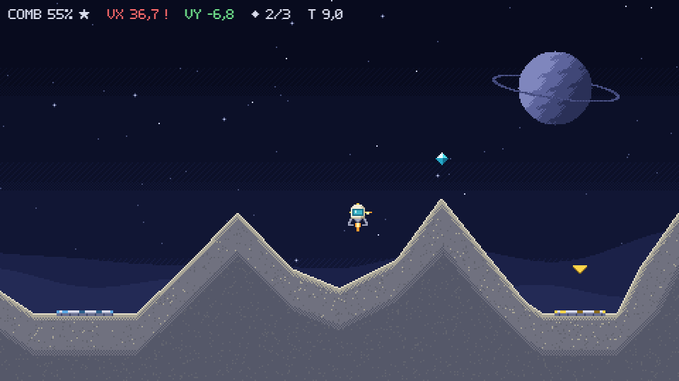
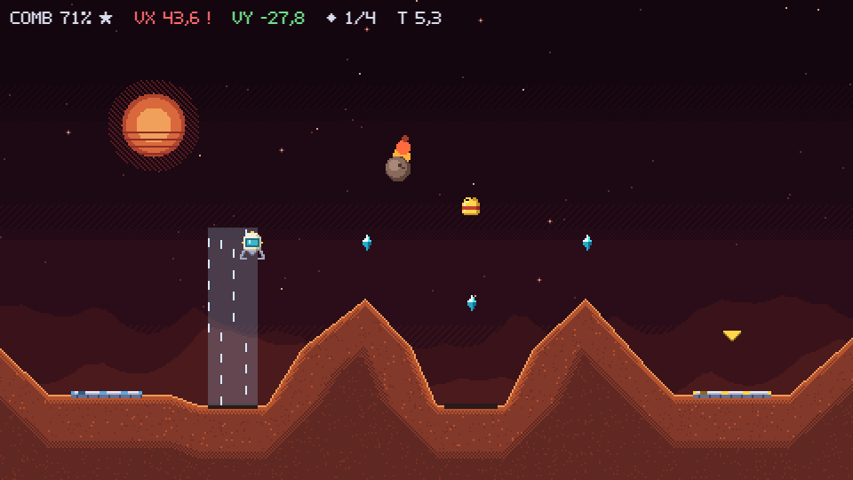
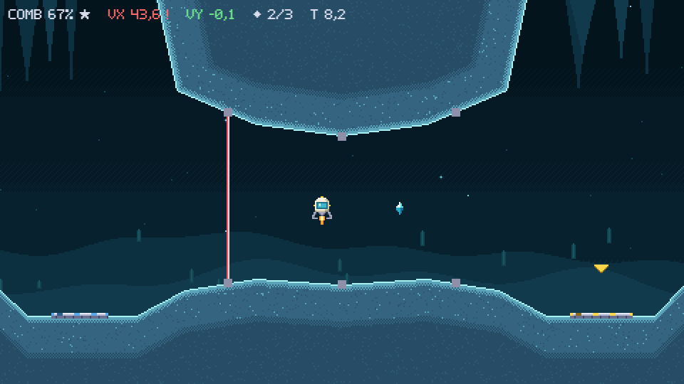

# Pouso Crítico

Jogo de navegador no gênero de pouso lunar. Decole de uma base, desvie do cenário e pouse com suavidade na outra antes que o combustível acabe.

**[Jogar agora](https://milamazim.github.io/pouso-critico/)**



## O jogo

- **10 fases em 3 mundos**, com meteoros, gêiseres, lasers e bases móveis
- **3 naves**: a Vaga-lume está disponível no início; o Besouro abre com 10 estrelas e a Libélula, com 20
- **3 conquistas por fase**: pousar, coletar todos os cristais e economizar combustível. As estrelas contam só o que foi feito no mesmo voo
- **Fantasma** do seu pouso mais rápido, para correr contra ele
- **Teclado, toque e gamepad**
- Progresso, recordes e opções salvos no próprio navegador, sem conta e sem servidor

| Cratera Rubra | Caverna Gélida |
|---|---|
|  |  |

## Controles

A nave fica sempre na vertical e tem três motores. O comando indica **para onde ela vai**.

| Ação | Teclado | Gamepad | Toque |
|---|---|---|---|
| Subir | ↑, W ou Espaço | A ou RT | ▲ |
| Esquerda e direita | ← → ou A/D | Direcional ou analógico | ◀ ▶ |
| Reiniciar | R | Y | ↻ |
| Pausar | Esc ou P | Start | ❚❚ |
| Ligar ou desligar o fantasma | G | Select | Menu de pausa |

Para pousar, os dois pés precisam tocar a plataforma com VX e VY em verde. No celular, jogue na horizontal.

## Como rodar

Requer [Node.js](https://nodejs.org/) 22.12 ou mais recente (versões 22, 24 ou 26).

```bash
npm install
npm run dev      # desenvolvimento, em http://localhost:5173
npm test         # testes
npm run build    # versão de publicação, em dist/
```

Em desenvolvimento, a tecla **T** abre um painel que ajusta a física e dá acesso às fases de teste.

## Como foi feito

TypeScript, Canvas 2D e Web Audio, **sem engine e sem dependências em produção**. Vite e Vitest são usados só no desenvolvimento.

- **Simulação separada da tela**, com passo fixo de 1/60 s: o mesmo comando dá o mesmo resultado em qualquer taxa de atualização
- **Colisão por pixel**, extraída dos próprios desenhos
- **Arte por código**: sprites em matrizes de texto, cenários procedurais e uma fonte bitmap montada como TrueType em tempo de execução
- **Som sintetizado**: músicas originais e efeitos, sem arquivos de áudio
- **Piloto automático nos testes**, que prova que as três estrelas de cada fase são possíveis num único voo com a nave inicial

```text
src/
├─ sim/       física, colisão, perigos, pouso, estrelas e fantasma
├─ data/      fases, naves e sprites
├─ render/    desenho da cena e HUD
├─ input/     teclado, toque e gamepad
├─ audio/     músicas e efeitos
├─ screens/   título, seleções, pausa, opções e resultado
├─ storage/   progresso salvo
├─ font/      fonte do jogo
├─ core/      laço de passo fixo
└─ debug/     painel de ajustes
```

As decisões de projeto estão em [PLANEJAMENTO.md](PLANEJAMENTO.md).

## Situação

A campanha está completa e foi concluída com as 30 estrelas usando a Vaga-lume. Ainda faltam testes em celular, Safari e gamepad reais, e o balanceamento das outras duas naves.

## Créditos e licença

Desenvolvido com o [Claude Code](https://claude.com/claude-code). O projeto ainda não tem licença definida: o código pode ser lido, mas não há permissão para reutilizá-lo.
